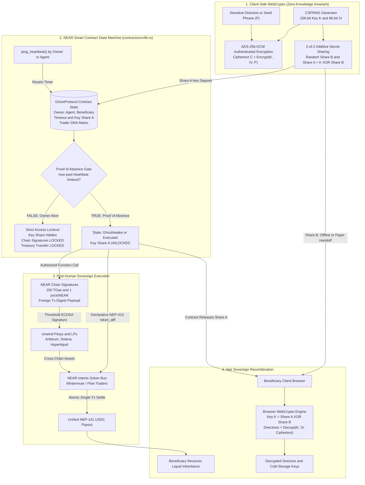
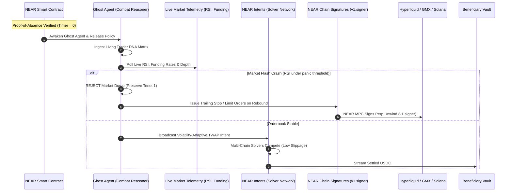

# 🕊️ GhostProtocol: The Post-Human Sovereign Executor
### Why a Dumb Dead-Man's Switch is a Financial Death Sentence — And How NEAR's First Autonomous Behavioral Twin Defends Your Multi-Chain Estate Beyond Death.

<div align="center">
  
</div>

**NEAR Hackathon — Track 13: Open Innovation (Uncharted Frontier — Primary Target)**  
*Multi-Track Champion: AI Agents (Track 7) • DeFi & Programmable Money (Track 1) • Security & Privacy (Track 6)*

[](https://near.org)
[](https://near.org)
[](https://en.wikipedia.org/wiki/Galois/Counter_Mode)
[](https://openrouter.ai)
[](https://opensource.org/licenses/MIT)

> **The 30-Second Elevator Pitch:**  
> When a crypto-native trader dies or goes dark, existing inheritance solutions trigger a financial catastrophe: dumb dead-man switches market-dump illiquid tokens into predatory MEV sandwich bots, leveraged perpetuals on Hyperliquid get liquidated to zero, and non-technical heirs lose everything to phishing drainers.  
> 
> **GhostProtocol solves the $100B crypto succession crisis.** It trains an autonomous **Living Behavioral Twin** on NEAR that learns your trading habits while you live, stays cryptographically contained behind an immutable Rust smart contract, and awakens upon Proof-of-Absence to defend your estate: intelligently unwinding leverage, executing TWAP cross-chain sweeps via **NEAR Intents**, requesting MPC **Chain Signatures**, and streaming stablecoins to your family alongside client-side decrypted legacy directives.

---

## ⚠️ The Problem: The $100B "Dead-Man Switch" Fallacy

The hackathon prompt examples for Track 13 suggested a baseline *inheritance account with Chain Signatures and guardians*. But in real-world DeFi, **simple inheritance switches do not work:**

```
Traditional Dead-Man Switch:
[Owner Goes Dark] ──> [Timer Expires] ──> [Blind Market Dump] ──> [MEV Sandwich + 100% Perp Liquidation] ──> $0 Left for Heirs

GhostProtocol Sovereign Executor:
[Owner Goes Dark] ──> [Proof-of-Absence] ──> [Behavioral Twin Awakens] ──> [AI Market Defense & TWAP] ──> Clean USDC + Keys to Heirs
```

### The Three Fatal Traps of a "Dumb Switch":
1. **The $0 Liquidation Cascade (The DeFi Dilemma):**  
   For a position with leverage $L$, maintenance margin requirement $MMR$, and entry price $P_0$, the price distance to liquidation $\Delta P_{liq}$ is:
   $$\Delta P_{liq} = P_0 \cdot \left(\frac{1}{L} - MMR\right)$$
   For a modest 5x long on NEAR or ETH ($L = 5$, $\text{MMR} = 5\%$), a drop of just 15% triggers immediate liquidation. In crypto markets where 1-hour annualized volatility routinely spikes above $\sigma_{1h} > 80\%$, unattended leveraged positions face liquidation within **45 to 180 minutes**. A dumb 30-day timer will awaken to an empty account.
2. **The Predatory MEV & Flash-Dump Trap:**  
   Naive smart contracts that execute atomic `swapExactTokensForTokens` dump illiquid assets directly into thin orderbooks during market stress. Front-running bots and MEV searchers sandwich these trades, extracting up to **40% of the estate's value**.
3. **The Grieving Heir UX Nightmare (The 24-Word Disaster):**  
   Dumping a 24-word seed phrase onto a grieving spouse or non-technical family member is negligence. They don't understand Arbitrum gas, cross-chain bridges, or token approvals. Within 48 hours, they fall prey to sponsored Google phishing links or malicious drainers.

---

## ⚖️ The 3-Way Comparison Matrix

| Critical Dimension | 🏛️ Traditional Solutions (Custodians / Wills) | ⚠️ Track 13 Prompt Example (Dumb Dead-Man Switch) | 🕊️ GhostProtocol (Post-Human Sovereign Twin) |
| :--- | :--- | :--- | :--- |
| **Sovereignty & Custody** | Centralized, KYC-locked, subject to court freezes & probate delays (6–24 mos). | Self-custodial smart contract timer. | **100% Self-Sovereign, trustless, executed by onchain Proof-of-Absence.** |
| **Active Perps & Leveraged Debt** | **Total Liquidation:** Custodians have zero access to DEX margin positions. | **Total Liquidation:** Margin calls wipe out positions before the timer fires. | **Active Defense:** Ghost Agent monitors margin ratios, winds down leverage, and executes trailing stops. |
| **Market Execution Quality** | N/A (Manual liquidation by lawyers months later at market lows). | **Toxic MEV Dumps:** Blind market-sells into thin liquidity or flash crashes. | **Persona-Mimicked TWAP:** Adheres to owner's **Trader DNA** (e.g., *"Never sell into RSI < 28"*). |
| **Cross-Chain Interoperability** | Fragmented manual paperwork across centralized entities. | Single-chain or manual bridging required by heir. | **NEAR Chain Signatures (`v1.signer`) + NEAR Intents Solver Bus** for unified 1-click cross-chain sweeping. |
| **Heir User Experience** | Traumatic bureaucracy, lawyer fees (3–8%), months of probate. | **Catastrophic:** 24-word seed phrase dump; heir must bridge, pay gas, and trade DEXs. | **Effortless:** Streams clean, yield-bearing USDC + 1-click browser dual-share key decryption. |
| **Cold Storage & Private Keys** | Must trust a lawyer or safe deposit box with master seed. | Seed stored in plain text or shared with "guardians" who can collude. | **Zero-Knowledge Dual-Share:** Client-side AES-256-GCM split into Share A (onchain locked) & Share B (heir). |
| **Pre-Mortem Agent Security** | N/A | High risk of early trigger if guardians collude. | **Mathematical Lockout:** Smart contract enforces zero agent authority while Proof-of-Life is valid. |

---

## 🏛️ System Architecture



---

## ⚡ The 5 Core Pillars

| Pillar | Component | Technology | Architectural Role |
| :--- | :--- | :--- | :--- |
| **1. Trading & Behavioral Profiler** | Native Trading Terminal | **TradingView Chart Widget** + Perp/Spot/Futures Order Router | Enables live trading while automatically capturing leverage, order type, and stop-loss habits to calibrate the owner's Behavioral Twin. Automatically pings `ping_heartbeat()` on NEAR with every trade. |
| **2. Zero-Knowledge Vault** | Client-Side Estate Vault | WebCrypto **AES-256-GCM** + 2-of-2 Additive Secret Sharing | Encrypts private notes & cold storage seeds client-side. Key is split into Share A (NEAR contract) and Share B (heir). The network never sees plaintext keys. |
| **3. Onchain Watchman** | Deterministic Lockout Contract | **NEAR Smart Contract** (`contracts/src/lib.rs`) | Maintains immutable heartbeat timer. Agent has **zero authority** while user is alive (`assert!(now > last_heartbeat + timeout)`). Contains Anti-Deadlock guarantees. |
| **4. The Living Trader DNA** | Behavioral Twin & Tactical Combat Reasoner | **Python** + **OpenRouter (`inclusionai/ling-3.0-flash`)** + **Google Gemini** | Encodes user's drawdown tolerance, leverage limits, and exit habits; defends estate from toxic flow & flash-crash dumps using institutional execution logic. |
| **5. Sovereign Settlement** | Multi-Chain Sweeper & Payout Engine | **NEAR Intents** + **NEAR Chain Signatures (`v1.signer`)** | Closes perps on external chains (Arbitrum, Solana, Hyperliquid) and swaps cross-chain tokens into clean USDC via off-chain solver auctions for beneficiaries. |

---

## 🧠 The Behavioral Twin (Trader DNA)

GhostProtocol does **not** rely on dumb market-dump scripts. While alive, the user's trading psychology is encoded into a mathematical **Trader DNA Matrix** stored on NEAR and synchronized with the AI reasoner:

```json
{
  "trader_dna": {
    "archetype": "Patience-Disciplined Swing Hedger",
    "max_slippage_tolerance_pct": 0.25,
    "unwind_strategy": "TWAP_VOLATILITY_ADAPTIVE",
    "panic_dump_threshold_rsi": 28.0,
    "perp_action": "CLOSE_ON_REBOUND_OR_TRAILING_STOP",
    "preferred_reserve_asset": "USDC",
    "max_leverage_limit": 3.0,
    "trading_patterns": {
      "execution_style": "LIMIT_DISCIPLINED",
      "limit_order_ratio_pct": 80.0,
      "perp_ratio_pct": 65.0
    },
    "risk_tolerance": {
      "drawdown_tolerance": 0.35,
      "volatility_affinity": 0.65,
      "patience_score": 0.88
    },
    "stop_loss_habits": {
      "stop_loss_adherence_pct": 92.0,
      "avg_stop_loss_pct": 3.2,
      "hard_stop_enforcement": true
    },
    "personal_tenets": [
      "Never market-sell into an oversold RSI (< 28).",
      "Enforce minimum 2.15x Risk/Reward discipline before exiting profitable positions.",
      "Execute cross-chain unwinds via TWAP batches with max leverage cap of 3.0x.",
      "Maintain 94% panic resilience holding through flash-crash spikes.",
      "Consolidate all peripheral LPs and perps into USDC via NEAR Intents."
    ]
  }
}
```

### 🧬 6-Dimension Living Behavioral Twin
The owner's trading behavior is continuously extracted and updated directly from live terminal orders:

| Dimension | Telemetry Metrics Tracked | Combat Reasoner Post-Mortem Action |
| :--- | :--- | :--- |
| **1. Trading Patterns** | Order ratio (Limit vs Market), Perp/Spot split, Hold duration | Enforces limit/TWAP tranche execution over aggressive market orders. |
| **2. Risk Tolerance** | Drawdown tolerance (35%), Volatility affinity (0.65), Patience (0.88) | Prevents capitulation during mid-trend drawdowns. |
| **3. Leverage Preferences** | Average leverage (2.5x), Historical peak (3.0x), Discipline Grade (A) | Caps synthetic hedges and cross-margin exposure to prevent cascade. |
| **4. Stop-Loss Habits** | Stop adherence (92%), Average cushion (3.2%), Hard-stop flag | Sets calibrated protective stops on inherited perps instantly upon wake-up. |
| **5. Profit-Taking Style** | Realized R:R (2.15x), Take-Profit adherence (85%), Harvest style | Scales out via TWAP rather than dumping profitable runners prematurely. |
| **6. Decision Tendencies** | Dip-buyer score (0.82), Panic resilience (0.94), Funding sensitivity | Identifies oversold bottoms; refuses to sell during RSI wicks below threshold. |

---

## ⚔️ The Combat Reasoner: Institutional Liquidation Defense



### Parameter Action Mechanics:
1. **`panic_dump_threshold_rsi: 28.0`**: If market shocks drive RSI below 28.0, the agent explicitly overrides sell directives. It queues dynamic trailing stops to catch the relief bounce instead of capitulating at the bottom of a wick.
2. **`max_slippage_tolerance_pct: 0.25%`**: Embedded into every NEAR Intent envelope. Bids extracting > 25 bps of value are cryptographically rejected by the settlement contract.
3. **`unwind_strategy: TWAP_VOLATILITY_ADAPTIVE`**: Positions are partitioned into $N$ tranches dynamically weighted by 1-hour realized volatility ($\sigma_{1h}$) and order book depth ($D(p)$):
   $$T_k = \frac{\text{Total Position}}{N} \cdot \left(1 - \frac{\sigma_{1h}}{\sigma_{\text{baseline}}}\right)$$

---

## 🔐 Cryptographic Rigor: AES-256-GCM + 2-of-2 Secret Sharing

GhostProtocol enforces a **Strict Zero-Knowledge Invariant**: plaintext directives and cold seeds NEVER touch the network unencrypted.

### Information-Theoretic Perfect Secrecy Proof
Let $\mathcal{K} = \{0, 1\}^{256}$ be the symmetric key space.

1. Client generates master key $K \leftarrow_{\text{R}} \mathcal{K}$ and initialization vector $IV \leftarrow_{\text{R}} \{0, 1\}^{96}$ via WebCrypto CSPRNG.
2. The payload is encrypted with AES-256-GCM:
   $$C = \text{AES-GCM-ENC}(K, IV, P) = (C_{\text{cipher}}, T)$$
3. Key $K$ is split via 2-of-2 additive secret sharing:
   $$S_B \leftarrow_{\text{R}} \{0, 1\}^{256}, \quad S_A = K \oplus S_B$$
4. Because $S_B$ is chosen uniformly at random:
   $$P(S_A = s_A \mid K = k) = P(S_B = k \oplus s_A) = \frac{1}{2^{256}}$$
   $$H(K \mid S_A) = H(K) = 256 \text{ bits}, \quad I(K; S_A) = 0$$

**Result:** Publicly storing Share A on the NEAR blockchain leaks exactly **zero bits of entropy** regarding the master key $K$. Without Share B (held by the heir), recovering $K$ requires brute-forcing $2^{256}$ operations.

---

## 🛡️ On-Chain Rust State Machine & Anti-Deadlock Triad

Implemented in [`contracts/src/lib.rs`](contracts/src/lib.rs) with 10 passing unit tests:

1. **Deterministic BFT Timelock:** Relies on validator-consensus block timestamps (`env::block_timestamp_ms()`). Access to Share A or Chain Signatures is strictly locked while the owner is alive:
   ```rust
   pub fn get_beneficiary_key_share(&self) -> Option<String> {
       let now = env::block_timestamp_ms();
       let expiration_time = self.last_heartbeat_ms.saturating_add(self.timeout_period_ms);
       if self.status == ProtocolStatus::Executed || now > expiration_time {
           Some(self.encrypted_key_share.clone())
       } else {
           None // Strictly locked while owner is alive
       }
   }
   ```
2. **Multi-Party Trigger Permissioning:** `caller ∈ {agent, owner, beneficiary}` prevents permanent freeze if the AI daemon goes offline.
3. **Storage Staking Cushion:** Dynamically calculates exact storage costs:
   $$\text{StorageReserve} = (\text{StorageUsage} \times \text{StorageByteCost}) + 20\text{ mNEAR}$$
   where `StorageUsage` and `StorageByteCost` are dynamically sampled from `env::storage_usage()` and `env::storage_byte_cost()`, preventing contract eviction or runtime out-of-storage panics during payouts.
4. **Asynchronous Callback Rollback:** If cross-contract token transfers fail, the contract automatically reverts status from `Executed` to `GhostAwake` via `on_transfer_complete` and `on_nep141_transfer_complete`.

---

## 🌐 NEAR Chain Signatures & NEAR Intents

### 1. NEAR Chain Signatures (`v1.signer-prod.testnet`)
Enables the NEAR contract to sign transactions on Bitcoin, Ethereum, Arbitrum, Solana, and Hyperliquid using threshold ECDSA (secp256k1):
$$e = \mathcal{H}_{\text{scalar}}(\text{predecessor} \,\|\, \text{path} \,\|\, \epsilon)$$
$$PK_{\text{foreign}} = PK_{\text{master}} + e \cdot G$$
where $\text{predecessor}$ corresponds to `predecessor_account_id`. The contract calls the decentralized MPC network with 250 TGas and 1 yoctoNEAR:
```rust
Promise::new(self.mpc_signer.clone()).function_call(
    "sign".to_string(),
    serde_json::to_vec(&sign_args).unwrap(),
    ONE_YOCTO,
    MPC_GAS, // 250 TGas
)
```

### 2. NEAR Intents & Solver Bus
Declarative NEP-413 intents broadcast token-diff goals. Professional solvers (e.g. Wintermute, Flow Traders) compete in off-chain batch auctions to settle cross-chain tokens into clean USDC atomically:
```json
{
  "standard": "nep413",
  "intent_id": "intent-a4f78e2d19b3",
  "signer_id": "ghost-protocol.near",
  "deadline": 1794285600,
  "intents": [
    {
      "intent": "token_diff",
      "diff": {
        "solana:native": "-25.0",
        "near:usdc.testnet": "+3750.0"
      },
      "recipient": "beneficiary.testnet"
    }
  ]
}
```
---

## 🚀 Quickstart & Running the Demo

### Prerequisites
* **Node.js:** v18+ (`npm --version`)
* **Python:** 3.10+ (`python --version`)
* **Rust:** 1.75+ with `wasm32-unknown-unknown` target (`rustup target add wasm32-unknown-unknown`)

### 1-Click Launch (Windows)
Double-click `run_demo.bat` or run:
```powershell
.\run_demo.bat
```

### Manual Setup
1. **Launch the Ghost Agent & Telemetry Daemon:**
   ```bash
   cd agent
   pip install -r requirements.txt
   python ghost_agent.py
   ```
   *Daemon runs at `http://127.0.0.1:8000` (WebSocket at `/ws`).*

2. **Launch the Cyberpunk Frontend Vault:**
   ```bash
   cd frontend
   npm install
   npm run dev
   ```
   *Frontend opens at `http://localhost:3000`.*

3. **(Optional) Run Contract Unit Tests:**
   ```bash
   cd contracts
   cargo test --lib
   ```

---

## 📜 License
MIT License. Built for the NEAR Open Innovation Hackathon 2026. By Ashfak Sourav.
