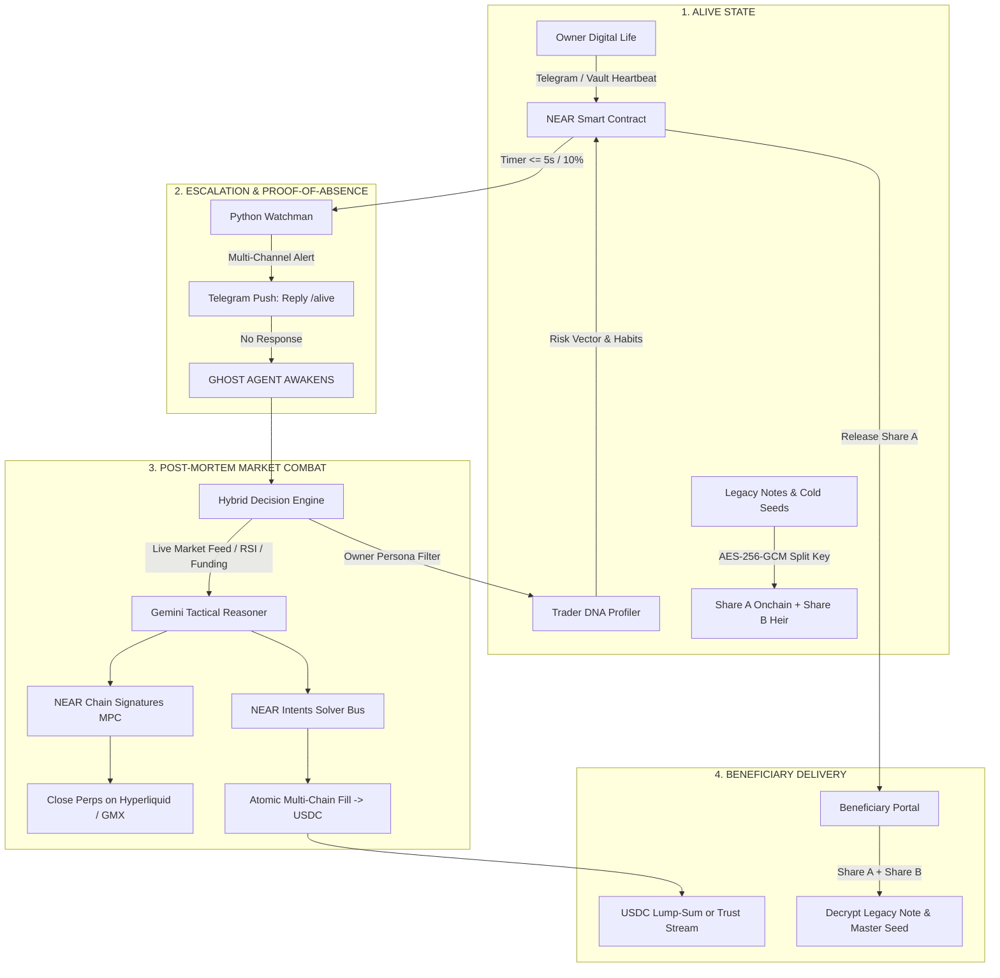

# 🕊️ GhostProtocol: The Post-Human Sovereign Executor
**NEAR Hackathon — Track 13: Open Innovation (Uncharted Frontier)**  
*Multi-Track Alignment: Autonomous Business • Privacy & Private AI • AI Security & Defense • Programmable Payments • Real-World Money*

[](https://near.org)
[](https://en.wikipedia.org/wiki/Galois/Counter_Mode)
[](https://openrouter.ai/models/inclusionai/ling-3.0-flash)
[](http://localhost:3000)

> **One-Line Pitch:** Instead of dumping raw seed phrases on non-technical heirs or trusting centralized custodians when you go dark, GhostProtocol activates an autonomous, cryptographically constrained "Ghost Agent" on NEAR that unwinds leveraged perps, mimics your trading psychology against predatory market conditions, consolidates cross-chain assets via NEAR Intents, decrypts local AES-GCM legacy directives, and streams stablecoins to your beneficiaries.

---

## 🌟 The Problem: The $100B+ Crypto Inheritance Black Hole

Traditional crypto inheritance solutions suffer from a catastrophic dilemma:
1. **Centralized Custodians:** Defeat the entire purpose of self-sovereignty; vulnerable to freezes, KYC blockades, and leaks.
2. **Raw Seed Phrase Handoffs:** Dumping 24 words onto grieving, non-technical family members who have no idea how to close perpetual futures on Arbitrum, bridge LP positions across 5 chains, or defend against MEV and phishing drainers.

**GhostProtocol** creates a **Post-Human Behavioral Twin**: a living, autonomous financial clone that stays strictly locked while you are alive, and wakes up on NEAR only when your cryptographic Proof-of-Absence expires.

---

## 🏛️ System Architecture



---

## ⚡ The 4 Core Pillars

| Pillar | Component | Technology | Role |
| :--- | :--- | :--- | :--- |
| **1. Zero-Knowledge Vault** | Client-Side Estate Vault | WebCrypto **AES-256-GCM** + XOR Dual-Share Key Splitting | Encrypts private notes & cold storage seeds client-side. The network never sees raw keys. |
| **2. Onchain Watchman** | Deterministic Lockout Contract | **NEAR Smart Contract** (`contracts/src/lib.rs`) | Maintains immutable heartbeat timer. Agent has **zero authority** while user is alive (`assert!(now > last_heartbeat + timeout)`). |
| **3. The Living Trader DNA** | Behavioral Twin & Market Reasoner | **Python** + **OpenRouter (`inclusionai/ling-3.0-flash`)** + `trader_dna_engine.py` | Encodes user's drawdown tolerance, leverage limits, and exit habits; defends estate from toxic flow & flash-crash dumps. |
| **4. Sovereign Settlement** | Multi-Chain Sweeper & Payout Engine | **NEAR Intents** + **NEAR Chain Signatures (`v1.signer`)** | Closes perps on external chains (Arbitrum, Solana, Hyperliquid) and swaps cross-chain tokens into clean USDC for beneficiaries. |

---

## 🧠 The Behavioral Twin (Trader DNA)

GhostProtocol does **not** rely on dumb market-dump scripts. While alive, the user's trading psychology is encoded into a mathematical **Trader DNA Matrix**:

```json
{
  "trader_dna": {
    "archetype": "Patience-Disciplined Swing Hedger",
    "max_slippage_tolerance_pct": 0.25,
    "unwind_strategy": "TWAP_VOLATILITY_ADAPTIVE",
    "panic_dump_threshold_rsi": 28,
    "perp_action": "CLOSE_ON_REBOUND_OR_TRAILING_STOP",
    "preferred_reserve_asset": "USDC",
    "risk_vector": {
      "drawdown_tolerance": 0.35,
      "volatility_affinity": 0.65,
      "patience_score": 0.85
    },
    "personal_tenets": [
      "Never market-sell into an oversold RSI (< 30).",
      "Always execute unwinds via TWAP batches across 3 intervals.",
      "Consolidate all peripheral LPs into USDC via NEAR Intents."
    ]
  }
}
```

When activated, the **Combat Reasoner** combines this Trader DNA with live orderbook depth, funding rates, and RSI metrics to execute gradual, optimal unwinds.

---

## 🔐 Dual-Share Key Splitting (Shamir / XOR)

1. Client generates a 256-bit symmetric key $K$.
2. The key is mathematically split into two shares:
   $$S_A \oplus S_B = K$$
3. **Share A:** Deposited into the NEAR contract. The contract strictly locks Share A and returns `None` while the owner is alive.
4. **Share B:** Retained by the beneficiary.
5. Upon Proof-of-Absence, the smart contract reveals Share A. The beneficiary combines both shares in the browser to decrypt the estate without third-party exposure.

---

## 🚀 Quickstart & Running the Demo

### Prerequisites
* **Node.js:** v18+ (`npm --version`)
* **Python:** 3.10+ (`python --version`)

### 1-Click Launch (Windows)
Double-click `scripts/run_demo.bat` or run:
```powershell
.\scripts\run_demo.bat
```

### Manual Setup
1. **Launch the Ghost Agent & Telemetry Daemon:**
   ```bash
   cd agent
   pip install -r requirements.txt
   python ghost_agent.py
   ```
   *Daemon runs at `http://127.0.0.1:8000` (WebSocket at `/ws`).*

2. **Launch the Cyberpunk Frontend Vault:**
   ```bash
   cd frontend
   npm install
   npm run dev
   ```
   *Frontend opens at `http://localhost:3000`.*

---

## 🎬 The 3-Minute Video Demo Script

| Timestamp | Phase | On-Screen Action | Voiceover / Narrative |
| :--- | :--- | :--- | :--- |
| **0:00 – 0:45** | **The Setup** | Open dashboard (`localhost:3000`). Type a sensitive legacy note with a cold-storage seed. Click **"Seal Vault"**. Observe Share A locked onchain and Share B generated for the heir. Calibrate **Trader DNA** to *"Disciplined Swing Hedger"*. | *"Meet GhostProtocol: a post-human sovereign executor on NEAR. We encrypt our sensitive keys with AES-256-GCM. The network never sees raw keys. And we calibrate our financial twin."* |
| **0:45 – 1:30** | **The Disappearance** | Watch the circular HUD countdown tick from `15s` down toward zero. Click **"Ping Heartbeat"** once to demonstrate life verification resetting the timer. Let the timer run down past `5s`. Observe status flip to **WARNING (Grace Period)**. | *"Every day you're alive, passive pings reset your timer. But if you disappear, the contract enters an emergency grace period, warning you on Telegram."* |
| **1:30 – 2:20** | **The Ghost Awakens** | Timer hits `00:00`. Status shifts to **GHOST AGENT AWAKE**. Switch to **"Ghost Agent Combat Feed"**. Watch the terminal stream live AI thoughts: RSI calculation, anti-dump constraint check, and NEAR Intent submission. | *"Timer expires. Proof-of-Absence is cryptographically confirmed on NEAR. The Ghost Agent loads the owner's Trader DNA and fires NEAR Intents to swap volatile tokens into USDC."* |
| **2:20 – 3:00** | **The Legacy Delivery** | Switch to **"Beneficiary Recovery Portal"**. Notice **Share A** has been released by the contract. Paste the heir's **Share B**. Click **"Decrypt Sovereign Legacy Document"**. Note and seed are revealed live on screen. | *"The smart contract releases Share A, streams the consolidated USDC, and the beneficiary decrypts the estate in seconds. Self-sovereign wealth passed on seamlessly."* |

---

## 🏆 Hackathon Multi-Track Alignment

* **Track 13 (Open Innovation — Primary):** Pioneers a post-human sovereign financial brain operating beyond physical human lifespan.
* **Autonomous Business:** Operates as a self-governed, autonomous estate treasury using NEAR Intents.
* **Privacy & Private AI:** Client-side zero-knowledge AES-256-GCM encryption with local telemetry.
* **AI Security & Defense:** Strict smart-contract deterministic sandbox prevents AI hallucinations from touching funds before expiration.
* **Programmable Payments:** Automated USDC streaming and conditional multi-chain releases.

---

## 📜 License
MIT License. Built for the NEAR Open Innovation Hackathon.
